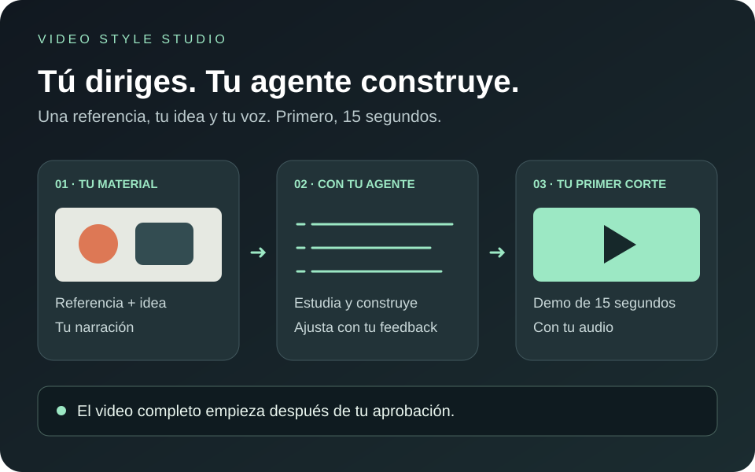

# Una referencia. Tu idea. Un video propio.

**Video Style Studio**

Dale a tu agente un video que te guste, cuéntale qué quieres decir y añade tu voz.
Primero ves 15 segundos. Tú decides si seguimos.

[**Empezar con mi agente →**](START-HERE.md) · [Qué incluye](#qué-incluye-y-hasta-dónde-llega) · [Ver las pruebas](https://github.com/lara-industries/video-style-studio/actions/workflows/ci.yml)

**Código abierto · Archivos en tu computador · Tu aprobación antes del completo**


---

## Tienes la idea. Tu agente se encarga del trabajo técnico.

Viste una animación y pensaste: esto me serviría para explicar lo mío.

Esta skill le da a tu agente un proceso para hacerlo: estudiar la referencia, guardar sus reglas visuales, construir una historia nueva y entregarte un MP4 que puedas revisar. Puedes dirigir con tus palabras: que entre más rápido, que la letra respire, que el golpe se sienta.

**Una skill es un manual que tu agente puede ejecutar.** Este paquete también incluye herramientas locales para analizar referencias, animar en 2D y editar grabaciones.

## Empieza pegando esto

Abre **Claude Code en modo Local**, **Codex** u otro agente con archivos, terminal local y visión. Si usas ChatGPT, comprueba que la sesión tenga esas capacidades; instalar su app por sí solo no basta.

```text
Lee https://github.com/lara-industries/video-style-studio/blob/main/START-HERE.md y guíame para instalar Video Style Studio y crear mi primera demo de 15 segundos.
```

**Necesitas:** un enlace de referencia, una idea y tu narración. Puedes grabar una nota de voz. No necesitas saber programar; sí necesitas un agente capaz de ejecutar el trabajo en tu equipo.

## Qué vas a tener

**Un estilo que puedes volver a usar.** Tu agente estudia la referencia y conserva sus reglas de composición, color, cámara y movimiento. La próxima pieza parte de esa ficha.

**Una primera versión que puedes ver y escuchar.** Una demo de 15 segundos con tu idea y tu narración. Sirve para decidir si el camino visual y el ritmo te gustan.

**Un video propio, después de tu aprobación.** Pides cambios antes de producir el completo. Conservas el MP4 y el proyecto local.

**Otra ruta si ya te grabaste.** El agente puede preparar cortes revisados y subtítulos sobre una grabación existente, manteniendo intacto el original.

## Cómo dirigir sin hablar en código

> Quiero explicar por qué esta idea importa. Me gusta el movimiento de esta referencia, pero quiero otro personaje y mi propia voz. Enséñame primero quince segundos.

Después de ver la demo, puedes pedir algo concreto:

> El texto se va demasiado pronto. Déjalo hasta terminar la frase y haz que el objeto frene antes de tocar el suelo.

Son ejemplos de instrucciones para tu agente, no promesas de fidelidad automática a cualquier referencia. La demo es donde compruebas el resultado.

## Así se trabaja

**01 · Preparar.** El agente comprueba tu equipo, explica lo que falta y pide permiso antes de instalar. Hay instrucciones para macOS, Windows y Linux.

**02 · Mirar.** Descarga la referencia cuando es accesible, conserva el texto original y extrae todos los cuadros. Después analiza lo que realmente puede ver y oír. Si el enlace falla o la técnica requiere otro motor, te lo dice antes de producir.

**03 · Probar.** Construye una escena propia con tu idea y tu audio. Te entrega un MP4 de 15 segundos para revisar estilo, voz y ritmo.

**04 · Decidir.** Pides cambios con tus palabras. El completo queda bloqueado hasta que apruebes la demo; si cambian sus entradas, hace falta revisarla otra vez.

[**Quiero empezar →**](START-HERE.md)

## Dos maneras de poner tu voz

**Tu grabación.** Una nota de voz o un archivo de narración. Puedes usar el flujo local sin pagar un proveedor de voz.

**ElevenLabs.** Una voz propia o autorizada, con tu cuenta y clave privada. El agente te guía; no pegues claves en el chat. Las generaciones consumen saldo de ElevenLabs y no están incluidas en la suscripción de tu agente.

## Qué incluye y hasta dónde llega

- **Animación 2D:** motor Python/Pillow + FFmpeg. El agente construye la escena según el análisis; el paquete no convierte cualquier referencia en una copia exacta con un clic.
- **Edición de grabaciones:** detección de candidatos de silencio, cortes revisados, captions, demo y aprobación. El agente decide los cortes con contexto; el detector no entiende por sí solo qué pausa importa.
- **Captura:** yt-dlp y un adaptador opcional de ScrapeCreators. Si la plataforma impide descargar, puedes aportar el archivo y su URL original.
- **Actualizaciones:** descarga la nueva versión cuando quieras actualizar. La skill no se actualiza silenciosamente ni es un servicio remoto.

Remotion, HyperFrames y Three.js pueden ampliar el trabajo de un agente, pero **no vienen implementados en este paquete**. Imagen real, actuación fotorrealista o simulación 3D compleja requieren otra herramienta o una adaptación acordada.

El resultado creativo depende de la referencia, los materiales y la escena que construya el agente. Revisa la demo: las pruebas técnicas no sustituyen tu criterio visual.

## Gratis, con los costes claros

El código y la skill son gratuitos bajo [licencia MIT](LICENSE). El motor local no requiere una clave de OpenAI. Tu agente puede necesitar una suscripción; ElevenLabs y ScrapeCreators son opcionales y cobran por separado. No incluye las suscripciones ni música de terceros.

La instalación requiere Python 3.10+, Pillow y FFmpeg/ffprobe. yt-dlp añade descargas; Whisper es opcional para transcribir localmente. El agente te explica qué necesita en tu sistema y lo instala solo con tu autorización.

## Por qué también hay un ZIP

El camino más sencillo es **pegar la línea de inicio en tu agente**. El código está visible en este repositorio.

El [ZIP de la última versión](https://github.com/lara-industries/video-style-studio/releases/latest) es una copia completa para quien prefiera descargarla: incluye `SKILL.md`, scripts, referencias, fuente y licencia. Instalar únicamente `SKILL.md` dejaría fuera las herramientas que necesita.

Conserva la carpeta completa. Tu agente explica qué falta instalar y cómo hacerlo en tu sistema antes de ejecutar cambios.

## Una herramienta que puedes inspeccionar

[Lee la skill](skills/video-style-studio/SKILL.md) · [Cómo analiza referencias](skills/video-style-studio/references/reference-analysis.md) · [Cómo edita grabaciones](skills/video-style-studio/references/recording-edit.md)

El [CI público](https://github.com/lara-industries/video-style-studio/actions/workflows/ci.yml) comprueba instalación aislada, exportaciones con audio, protección de originales y bloqueo del completo sin aprobación. Ejecuta el flujo en macOS, Windows y Linux. Las pruebas usan patrones y tonos sintéticos: acreditan funcionamiento, no una voz natural ni fidelidad estética a cualquier creador.

Para inspeccionar el motor:

```sh
python skills/video-style-studio/scripts/studio.py doctor
python skills/video-style-studio/scripts/studio.py --help
python -m unittest discover -s tests -p 'test_*.py' -v
python tests/integration.py --output /ruta/vacia/prueba
```

La escena es código Python local que el agente debe revisar antes de ejecutar; el paquete no es un sandbox. La fuente incluida es Noto Sans, con [licencia SIL OFL](skills/video-style-studio/assets/fonts/OFL.txt).

## La próxima vez, ya tienes un punto de partida

```text
Usa video-style-studio con mi estilo <nombre>.
Quiero explicar <idea> con esta narración: <archivo>.
Muéstrame primero 15 segundos.
```

Si no guardaste un estilo, el agente empieza por pedirte una referencia. Tus proyectos, referencias y voces se quedan fuera de este repositorio.

---

Creado por **[Sebastián Lara](https://www.instagram.com/sebastianlara.io/)**, ingeniero de software. Construyo herramientas para tus agentes, para que puedas recuperar tiempo y sacar tus ideas al mundo.

[**Empezar gratis →**](START-HERE.md) · [Seguir el proyecto en Instagram](https://www.instagram.com/sebastianlara.io/)
